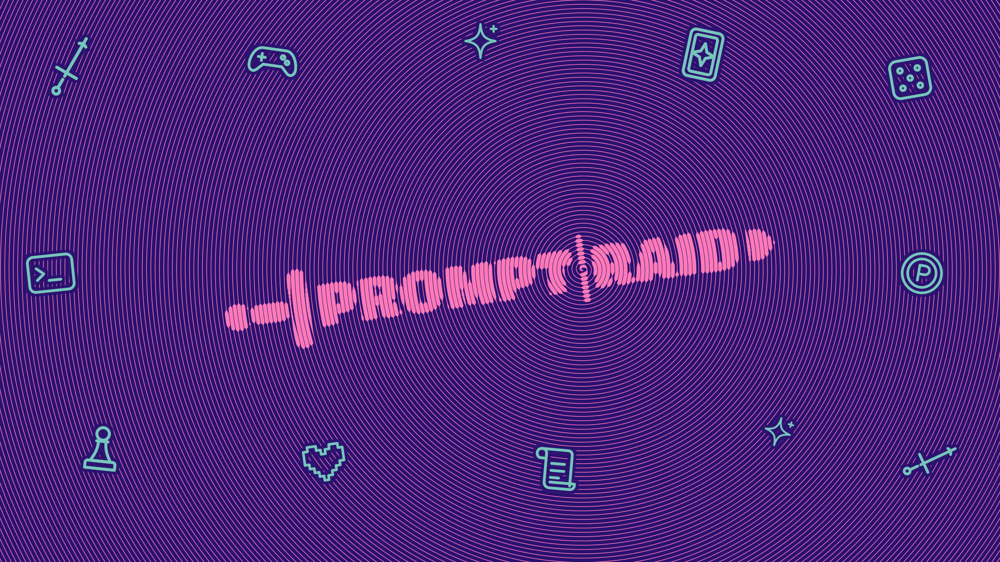
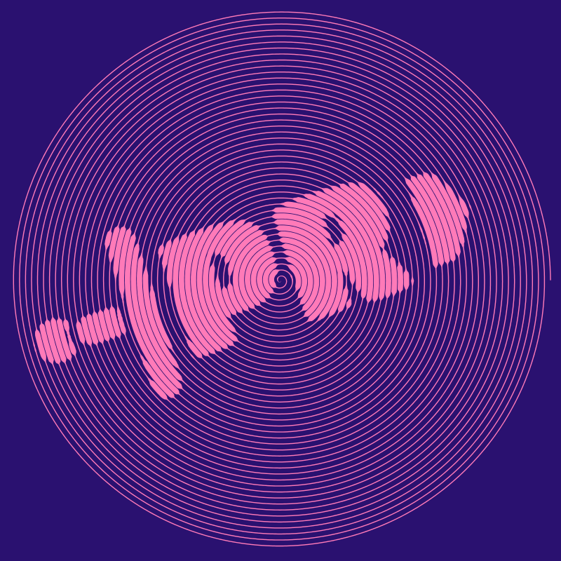
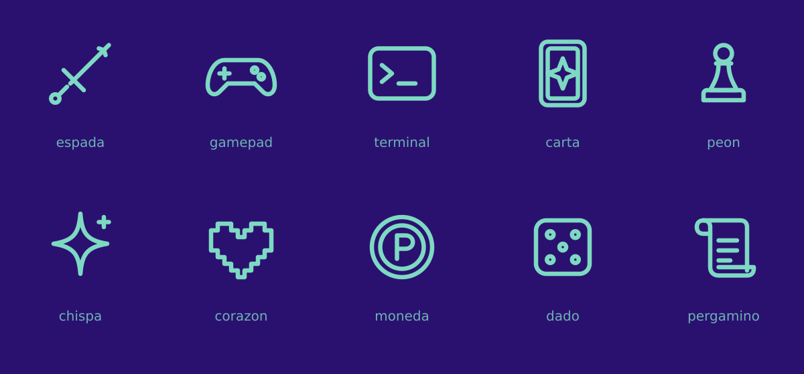

# PromptRaid · Manual de marca

Versión del 21 de noviembre de 2026

## Concepto

PromptRaid es un canal de YouTube en español sobre IA y desarrollo de juegos: se hacen juegos con IA, se juegan y se regalan los prompts. La marca dice eso en una imagen: una espada (el "raid", la aventura) cuya vaina es el nombre, dibujada por una sola línea en espiral.

**Propósito:** aprovechar la IA para hacer todas las ideas que siempre tuve, pero para las que nunca había tiempo. Cada video es una de esas ideas hecha realidad, y el prompt queda para que cualquiera la pueda hacer también.

El espiral es un **espiroglífico**: una línea continua que da vueltas desde el centro y se engrosa donde está el logo. De lejos se lee el nombre; de cerca se ve la línea. Es la idea del canal: algo simple (un prompt) que, vuelta tras vuelta, termina siendo un juego.

**Personalidad:** juguetona, curiosa y nocturna. Habla de tecnología sin solemnidad: se divierte con lo que hace la IA. Es de noche, de pantalla y de partida larga.

## Logo

El logo tiene dos versiones del mismo espiroglífico: la principal, con el nombre completo, y el avatar, con las iniciales.

| Versión | Qué muestra | Vueltas | Dónde se usa |
| --- | --- | --- | --- |
| Principal | Espada larga inclinada 8°, vaina PROMPT \| RAID | Una cada ~11 px, unas 150 vueltas (cubre todo el fondo) | Portada del canal, intros, piezas grandes |
| Avatar PR | Espada en diagonal, vaina PR | 45 | Foto de perfil, marca de agua |

**Construcción:**

1. La base es la silueta de espada y vaina en Titan One, heredada de la exploración uva-lima, sin cambios de forma.
2. Una espiral de Arquímedes sale del centro. Su línea mide 1,4–1,6 px fuera del logo y llega al 90 % del espacio entre vueltas dentro del logo.
3. En la versión principal, el centro del espiral cae sobre la barra entre PROMPT y RAID. En el avatar, cae entre la P y la R. Así el centro no deforma ninguna letra.
4. La línea es una sola: no se corta ni se rellena el logo por separado.

**Zona de respeto:** el avatar es un círculo completo; no se recorta ni se le pone marco. En la portada, el logo va siempre dentro de la zona segura de YouTube (1546 × 423 px al centro).

**Tamaños mínimos:** avatar a 48 px de diámetro (por debajo, las vueltas se empastan). La versión principal, a 600 px de ancho como mínimo; más chica, usá el avatar. Para 16–32 px (favicon, por ejemplo) va una versión simplificada: espada y "PR" llenos en chicle, sin espiral. Está pendiente de hacer.

## Paleta

Tres colores: un fondo oscuro, un acento rosa que es la marca y un apoyo menta que nunca le gana al rosa.

| Color | Hex | RGB | Rol | Superficie aproximada |
| --- | --- | --- | --- | --- |
| Uva noche | #2A1170 | 42, 17, 112 | Fondo de todo | 70 % |
| Chicle | #FF7AB8 | 255, 122, 184 | Acento: logo, espiral, títulos clave | 20 % |
| Menta | #7ED9C3 | 126, 217, 195 | Apoyo: íconos, detalles, datos secundarios | 10 % |

**Reglas:**

- El chicle es el único color fuerte de cada pieza. Si algo tiene que llamar la atención primero, va en chicle.
- La menta acompaña en poca superficie: íconos, subrayados, números chicos. Nunca un fondo grande en menta.
- Chicle y menta no se tocan ni se superponen: siempre hay uva noche entre los dos.
- Para textos largos sobre uva noche, usá blanco cálido #FFF9F7; el chicle queda para títulos y palabras clave.
- Cada juego fusionado puede tener su propia paleta adentro del video, pero la marca (logo, intro, cierre) siempre va en esta.

## Tipografía

La tipografía de la marca es **Titan One**: redonda, gruesa y amigable, la misma del nombre en la vaina. Es gratuita en [Google Fonts](https://fonts.google.com/specimen/Titan+One).

| Uso | Fuente | Color sobre uva noche |
| --- | --- | --- |
| Logo, títulos de video, números grandes | Titan One | Chicle |
| Subtítulos y textos en pantalla | Titan One, más chica | Blanco cálido #FFF9F7 |
| Etiquetas, puntajes, datos chicos | Titan One | Menta |

- Titan One tiene un solo peso: la jerarquía se arma con tamaño y color, no con negrita.
- Siempre en mayúsculas para títulos cortos (hasta 4 palabras); en mayúscula y minúscula para frases largas.
- No se deforma, no se estira y no se le pone contorno ni sombra.
- Para textos muy largos (descripciones, sitio web) se puede usar una sans legible como Inter, pero nunca en el logo ni en títulos.

## Íconos de relleno

Los íconos son de línea, en menta, y sirven para llenar la portada y acompañar los videos sin competir con el logo.

**Estilo:** solo trazo, sin relleno. Grilla de 48 × 48, trazo de 2,4–2,6 en esa grilla, puntas y uniones redondeadas. Un ícono no lleva más de un color.

**Set actual (10):** espada, gamepad, terminal, carta, peón, chispa, corazón pixel, moneda, dado y pergamino.

**Próximos de la lista:** calavera de jefe, trofeo, X y O del tateti, celda de sudoku, cursor, globo de chat, flechas y círculo de resaltado para videos.

- En la portada van fuera de la zona segura, girados entre −20° y 20°, sin tocarse entre sí.
- Detrás de cada ícono se corta el espiral (un margen de uva noche), para que las líneas no se mezclen.
- Las cartas de los juegos fusionados son genéricas: nunca se copia el diseño de Yu-Gi-Oh ni de otro juego.
- Un ícono nuevo sigue la misma grilla y el mismo trazo; si no se lee a 32 px, se simplifica.

## Aplicaciones

Cada pieza del canal usa una versión fija del logo y un tamaño fijo.

| Pieza | Tamaño | Versión | Notas |
| --- | --- | --- | --- |
| Foto de perfil | 800 × 800 px | Avatar PR | YouTube la recorta en círculo; el espiral ya es circular |
| Portada del canal | 2560 × 1440 px | Principal + íconos menta | Logo dentro de 1546 × 423 al centro; íconos afuera |
| Marca de agua | 150 × 150 px | Avatar PR | Abajo a la derecha de los videos |
| Intro y cierre de video | 1920 × 1080 px | Principal | El espiral puede dibujarse en vivo desde el centro hacia afuera |
| Miniaturas | 1280 × 720 px | Avatar PR chico en una esquina (mínimo 48 px) | El juego manda; el título en Titan One chicle, máximo 4 palabras |
| Sitio web | — | Avatar PR en el encabezado, principal en la portada | Fondo uva noche, botones chicle, etiquetas menta |

**En los videos:**

- Fondo uva noche para placas, títulos y transiciones; el gameplay va con su propia paleta.
- Títulos de segmento ("juegos fusionados") en Titan One chicle; datos y puntajes en menta.
- Los íconos SVG se escalan y animan en CapCut sin perder calidad: entrada con rebote corto, nada de giros largos.
- El espiral sirve como transición: se enrosca hacia el centro al cerrar una sección y se desenrosca al abrir la siguiente.

**Identidad:** PromptRaid funciona como marca y producto. En ninguna pieza (videos, sitio, repos, créditos) aparece un nombre personal; todo se firma como PromptRaid.

## Usos incorrectos

Estas cosas rompen la marca y no se hacen:

- Cambiar los colores del logo por otros fuera de la paleta (lima, naranja y los demás quedaron en las exploraciones).
- Poner el logo en menta, o el espiral en un color y las letras en otro.
- Rellenar las letras en vez de dibujarlas con la línea del espiral.
- Estirar, aplastar o girar el logo a otro ángulo que no sea el suyo (8° la principal, diagonal el avatar).
- Usar la versión principal en tamaños chicos: debajo de 600 px va el avatar.
- Poner el logo sobre una foto o un gameplay sin una placa uva noche detrás.
- Agregarle sombra, contorno, brillo o degradado.
- Llenar la zona segura de la portada con íconos o textos.
- Usar la marca vieja (espada pixel Fuego o uva-lima) en piezas nuevas.

## Kit de archivos

Todo está en la carpeta `marca-noche-chicle`.

| Archivo | Formato | Para qué |
| --- | --- | --- |
| youtube-perfil-PR-800x800 | PNG, SVG | Foto de perfil |
| youtube-banner-2560x1440 | PNG, SVG | Portada sin íconos |
| youtube-banner-con-iconos-2560x1440 | PNG | Portada final con íconos menta |
| youtube-marca-de-agua-150x150 | PNG | Marca de agua de los videos |
| iconos/icono-*.svg | SVG | Los 10 íconos sueltos, en menta |
| iconos/set-iconos.svg | SVG | Hoja con todos los íconos |

- Para subir a YouTube, usá los PNG. El SVG de la portada pesa unos 9 MB y es para editar.
- Pendiente: favicon e íconos para el sitio de juegos, que todavía usa la marca Fuego.
